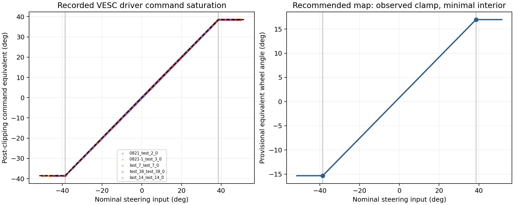
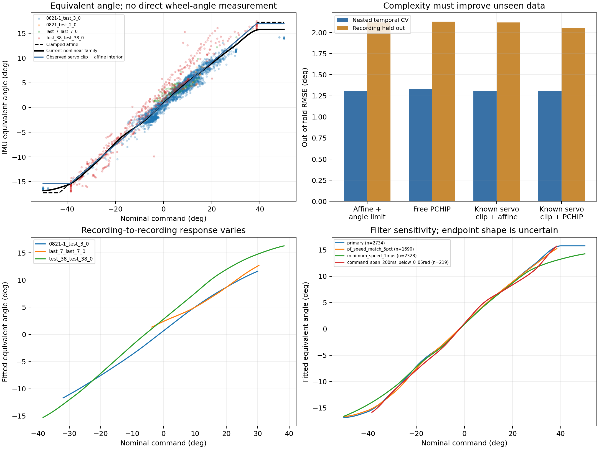

# 조향 매핑 독립 검토

권장 기본값은 **실제 드라이버의 서보 입력 포화 + 포화 구간 안의 단순 보정식**이다. 전체 매핑은 비선형이며, 현재 bag만으로 포화 구간 안의 기계 링크 곡률까지 확정하지 않는다. 적용용 파일은 `recommended_steering.yaml`, 대안 곡선은 `alternative_curved_steering.yaml`이다. 기존 시뮬 설정과 GUI는 이 검토에서 변경하지 않았다.

## 실제로 확인한 비선형 동작

다섯 MCAP에서 `/sensors/servo_position_command`를 추가로 해독했다. 이 토픽은 바퀴 각도 센서가 아니라 **VESC 드라이버가 제한을 적용한 뒤 전송한 서보 명령의 echo**다. 로컬 `vesc_driver.cpp`의 `servoCallback()`도 `servo_limit_.clip()` 뒤 같은 값을 전송하고 발행한다.

- `/commands/servo/position`은 제한 전 명령이다.
- 다섯 기록 모두 echo의 최소/최대는 정확히 `0.15 / 0.85`였다.
- 수신 시각 차이가 10 ms 미만인 대응 값에서 `echo == clip(command, 0.15, 0.85)` 비율은 기록별 **99.983%~100%**였다. 드문 불일치는 대응 시각의 경계에 있다.
- 기존 `/drive`와 서보 명령의 대응은 `p = 0.5 + 0.52 u`이다. 따라서 nominal 조향 입력은 `u = ±(0.35/0.52) = ±0.6730769231 rad`, 즉 약 **±38.56°**부터 포화한다. 사용자 입력 한계 ±50°까지 링크의 추가 움직임을 가정하면 안 된다.
- 현재 체크아웃의 `vesc.yaml`은 gain `-0.52`지만 이 bag의 실행 명령은 `+0.52`에 대응한다. 이 검토는 기록된 동작의 부호를 사용했다.

이 포화는 데이터와 드라이버 코드로 확인한 사실이다. 서보 PWM 명령과 실제 축/바퀴 각도 사이의 기구학은 별개다.



## 권장 적용값

`u`가 `cmd_vel.angular.z`에 대응하는 nominal 조향각일 때:

```text
u_effective = clip(u, -0.673076923076923, +0.673076923076923)
delta_equivalent = 0.014131439965515014 + 0.4184748463865287 * u_effective
```

현재 C 코드의 `monotone_pchip` API에 두 knot로 넣으면 이 식을 정확히 표현한다. 코드 변경은 필요 없다.

```yaml
model: monotone_pchip
input_limit_rad: 0.673076923076923
input_knots_rad: [-0.673076923076923, 0.673076923076923]
wheel_angle_knots_rad: [-0.2675343220254177, 0.29579720195644776]
```

입력 0의 등가각은 약 +0.81°다. 이것도 실제 정렬 오차, IMU/차량 동역학, 잔여 슬립이 섞인 추정이며 정적 바퀴 센서로 측정한 기계 trim은 아니다. 원래 INI의 `delta_max=0.301 rad`, `t_delta=0.07 s`, 실차 휠베이스 `0.26 m`를 유지했다. 원래 시뮬 USD 휠베이스 `0.25 m`와의 차이도 유지해 기록한다.

로컬 C 라이브러리에 권장 YAML을 그대로 로드해 입력 -1~+1 rad의 2,001점을 비교했다. 해석식 대비 최대 차이는 `2.22e-16 rad`였고 포화/단조성/유한값 확인을 통과했다. 결과는 `native_recommended_mapping_check.json`에 있다. 이 검사는 현재 실행 중인 GUI를 조작하지 않았다.

## 데이터와 검증

원본 다섯 MCAP의 토픽 목록과 메시지 수를 재확인했다. `cmd_vel`이나 실제 바퀴 각도 토픽은 없다. `last_14`에는 `/drive` 채널 정의만 있고 메시지는 0개다. 따라서 `/drive`를 사용하되 실행 서보 명령과 일치하는 경우만 택한 기존 선정 방법을 유지했다.

필터는 전진 0.6~2.5 m/s, 종방향 가속도 절댓값 ≤0.5 m/s², 추정 횡가속도 ≤1.5 m/s², IMU quaternion yaw 미분과 gyro의 일치, PF 위치로 구한 속도와의 일치다. 최종 **2,734개 50 Hz 샘플, 합계 54.68초**를 사용했다. yaw/속도에는 0.3초, PF 위치에는 0.5초 평활 창이 쓰였다. 최대 0.25초의 중심 창 반폭에 비해 긴 **0.5초 embargo**를 검증 경계에 적용했다. 획득 간격 >100 ms의 양옆 0.3초에 걸친 선정 샘플은 0개였다.

| 기록 | 선정 시간 | 샘플 |
|---|---:|---:|
| 0821-1/test_3 | 42.74 s | 2,137 |
| 0821/test_2 | 0.36 s | 18 |
| ifac/last_7 | 1.90 s | 95 |
| ifac1/test_38 | 9.68 s | 484 |
| ifac2/last_14 | 0 s | 0 |

최초 분석의 2초 단일 holdout은 곡선 정규화 계수 선택에도 재사용되었다. 그 holdout의 약 1.50°는 새 검증 수치와 직접 비교해 개선폭으로 표현하지 않는다. 이번 검토는 20초 외부 블록 5-fold, 10초 내부 블록 3-fold로 PCHIP의 정규화 강도를 선택했다. 같은 기록을 섞는 시간 검증과 별도로 기록 전체를 하나씩 제외해 전이 오차도 구했다. 모든 후보에 같은 0.07초의 기존 관측 지연을 적용했다. 따라서 지연 자체는 새 맹검 추정치가 아니다.

| 매핑 | 시간블록 외부 CV RMSE | 기록 전체 제외 RMSE |
|---|---:|---:|
| affine + INI 바퀴각 제한 | 1.303° | 2.119° |
| 기존 자유 PCHIP + INI 제한 | 1.336° | 2.129° |
| **실제 서보 포화 + affine 내부 (권장)** | **1.303°** | **2.120°** |
| 실제 서보 포화 + 좌우 두 기울기 | 1.297° | 2.045° |
| 실제 서보 포화 + 단조 PCHIP 내부 | 1.305° | 2.055° |

좌우 두 기울기와 내부 PCHIP는 근소한 차이로, 시간블록 bootstrap의 오차 차이 신뢰구간이 0을 포함한다. 즉 더 복잡한 내부 곡선의 우수성은 확인되지 않았다. 표본과 모델 선택의 불확실성을 고려해 가장 단순한 내부 보정을 권장한다. 권장 모델의 외부 CV 절대오차 95백분위는 약 2.67°, 기록 전체 제외 시 약 3.73°다. 모두 **등가각 오차**이며 기계 각도 측정 정확도를 뜻하지 않는다.



## 해석의 한계

레이블은 `atan(0.26 * IMU_yaw_rate / wheel_speed)`다. 네 바퀴를 구동하고 센터 디프가 없는 차량에서는 저속에서도 타이어의 미끄러짐과 선회 경로 차이로 휠 속도와 후차축 가운데의 지상 속도가 같지 않을 수 있다. PF 속도 필터는 이를 줄이기 위한 일관성 확인이며 독립 정답은 아니다. IMU yaw도 차체의 회전을 측정하므로 실제 바퀴 각도를 바로 측정하지 않는다.

선정 샘플의 약 78%가 한 기록에 있다. 음수 큰 입력은 주로 `test_38`, 양수 작은 입력은 주로 `test_3`에 있어 기록별 trim/슬립이 링크 비선형처럼 보일 수 있다. 기록별 상수 오프셋을 허용한 진단에서도 약 1.2°의 기록 차이가 나타난다. 기존 자유 PCHIP의 -0.75 rad 이하 19개는 단 1개의 2초 블록, +0.75 rad 이상 10개는 2블록에만 있어 끝단 곡률 근거가 특히 약했다. 실제 서보 포화를 먼저 넣으면 그 구간은 추가 자유도가 필요 없다.

PF 속도 허용오차를 5%로 줄이거나 속도 하한을 1 m/s로 높이거나 0.2초 안의 조향 명령 변화가 0.05 rad 미만인 구간만 고르면, 큰 조향각의 추정 곡선이 달라진다. 이 민감도는 `report.json`에 보존했다. 내부 링크의 비선형을 따로 확정하려면 정지/저속에서 서보 명령을 천천히 왕복시키면서 실제 좌우 바퀴각을 측정한 자료가 필요하다. 이 추가 측정은 현재 요청을 완료하는 조건으로 삼지 않았다.

재현 명령:

```bash
/tmp/damvi-bag-tools/bin/python tools/review_steering_model.py \
  calibration/steering/aligned -o calibration/steering_review
```

원본 MCAP/INI와 기존 시뮬 설정은 읽기만 수행했다. 모든 새 파일은 `calibration/steering_review/`와 `tools/review_steering_model.py`에만 썼다.
